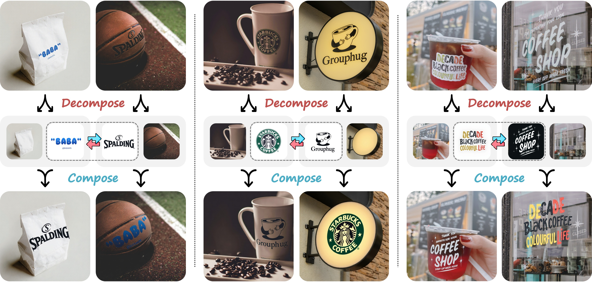

# Cycle-Consistent Tuning for Layered Image Decomposition (CVPR 2026)

<div align="center">

### [Paper](https://arxiv.org/abs/2602.20989) | [Project Page](https://edward3862.github.io/ImgDecom/)

[Zheng Gu](https://edward3862.github.io/)<sup>1</sup> · [Min Lu](https://deardeer.github.io/)<sup>1</sup> · [Zhida Sun](https://zhdsun.github.io/)<sup>1</sup> · [Dani Lischinski](https://www.cs.huji.ac.il/~danix/)<sup>2</sup> · [Daniel Cohen-Or](https://danielcohenor.com/)<sup>3</sup> · [Hui Huang](https://vcc.tech/~huihuang)<sup>1</sup>

<sup>1</sup>Shenzhen University · <sup>2</sup>Hebrew University of Jerusalem · <sup>3</sup>Tel-Aviv University

</div>

---

<div align="center">
  
</div>

---

## Abstract

We present an **in-context image decomposition framework** that leverages large diffusion foundation models for layered separation. Our method focuses on the challenging case of **logo-object decomposition**, where the goal is to disentangle a logo from the surface on which it appears while faithfully preserving both layers.

Our approach introduces:

- **Cycle-Consistent Tuning**: Joint training of decomposition and composition models with reconstruction consistency
- **LoRA Adaptation**: Lightweight fine-tuning of pretrained diffusion models
- **Progressive Self-Improvement**: Iterative training set augmentation with high-quality model-generated examples

The method achieves accurate and coherent decompositions and generalizes effectively across other decomposition types (intrinsic decomposition, foreground-background separation), suggesting its potential as a unified framework for layered image decomposition.

---

## Setup

```bash
git clone https://github.com/edward3862/ImgDecom.git
cd ImgDecom
uv venv --python 3.12 .venv
uv pip install --python .venv/bin/python -r requirements.txt
source .venv/bin/activate
```

---

## 🚀 Model & Code

The inference uses `black-forest-labs/FLUX.1-Fill-dev` with our [LoRA weights](https://huggingface.co/picana/ImgDecom).

Download the weights to the path expected by the inference scripts:

```bash
hf download picana/ImgDecom pytorch_lora_weights.safetensors --local-dir checkpoints
```

For the provided examples and test-set inference, download the [logo-product test dataset](https://huggingface.co/datasets/picana/ImgDecom):

```bash
hf download picana/ImgDecom --repo-type dataset --local-dir data/logo_product_test
```

### Decompose one image

For the example three-panel input, run:

```bash
bash scripts/inference_single_image.sh
```

You can also provide an image and decomposition prompt directly:

```bash
python inference_single_image.py \
  --input-image path/to/image.png \
  --input-format image \
  --decomp-prompt "A stepwise decomposition of branding elements. [LEFT]: {an object with a logo.} [MIDDLE]: {the isolated logo.} [RIGHT]: {the object without the logo.}"
```

Set `--input-format grid` for an existing 1536 × 512 three-panel image. With `--input-format image`, the script scales the image to fit a 512 × 512 panel, pads it if needed, and places it on the left of a three-panel grid.

### Run the test set

```bash
bash scripts/inference.sh
```

The script processes the PNG inputs in `data/logo_product_test/grid/`. Each `image_XXXXX.png` needs matching `image_XXXXX_decomp.txt` and `image_XXXXX_comp.txt` files in the same directory. For each input, it saves a decomposition image (`_decomp.png`) and a recomposed image (`_recomp.png`). To set the input or output directory explicitly, run:

```bash
python inference.py \
  --folder data/logo_product_test/grid \
  --output-dir output/test_set
```

---

## Citation

If you find this work useful for your research, please cite:

```bibtex
@inproceedings{gu2026cycle,
  title={Cycle-Consistent Tuning for Layered Image Decomposition},
  author={Gu, Zheng and Lu, Min and Sun, Zhida and Lischinski, Dani and Cohen-Or, Daniel and Huang, Hui},
  booktitle={Proceedings of the IEEE/CVF Conference on Computer Vision and Pattern Recognition (CVPR)},
  year={2026}
}
```
